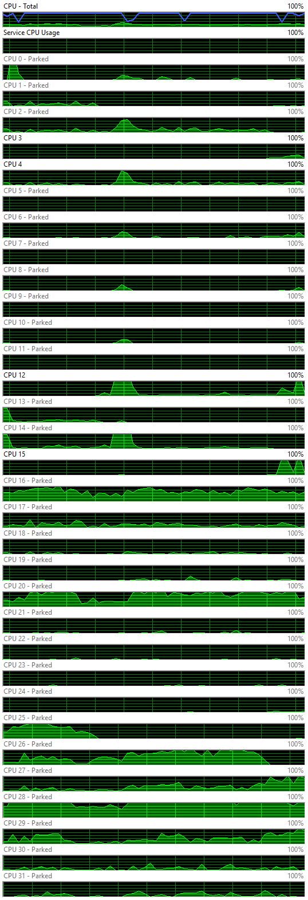
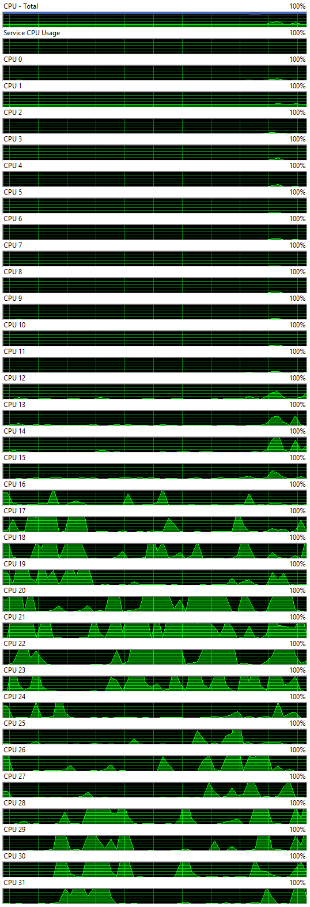

<div align="center">

# CPU Parking Disabler

**Check whether Windows parks your cores. Unpark every core with one command.**

Disables CPU core parking (a.k.a. **unparking your CPU cores**) and sets Energy Performance Preference to maximum on Windows 10/11.
Zero install. Zero dependencies. Shows the parked-core count before and after. Built-in undo.

[](https://github.com/vadyaravadim/cpu-parking-disabler/actions/workflows/ci.yml)
[](LICENSE)
[](https://www.microsoft.com/windows)
[](https://docs.microsoft.com/en-us/powershell/)
[](https://github.com/vadyaravadim/cpu-parking-disabler/releases)
[](https://www.powershellgallery.com/packages/cpu-parking-disabler)
[](https://github.com/vadyaravadim/cpu-parking-disabler/stargazers)

**[Read the deep dive with measured benchmarks →](https://rigpolice.com/system/articles/disable-cpu-core-parking/?utm_source=github&utm_medium=readme&utm_campaign=cpu-parking-disabler)**

**Part of the [RigPolice Latency Toolbox](https://rigpolice.com/system/latency-toolbox/?utm_source=github&utm_medium=readme&utm_campaign=cpu-parking-disabler) — six open-source Windows latency scripts, with what we measured and what we have not yet**

If it works for you, a ⭐ helps others find it.

</div>

---

## Quick Start

**Easiest — one line, in any PowerShell** (it self-elevates):

```powershell
irm https://github.com/vadyaravadim/cpu-parking-disabler/releases/latest/download/cpu-parking-disabler.ps1 | iex
```

The script saves itself to `%USERPROFILE%\cpu-parking-disabler.ps1` and reruns from there; an existing copy at that path that differs is kept as `.bak`. The undo file is written next to it. The `irm | iex` pipe itself takes no switches - run the saved copy instead, see the switch table below.

**Check it before it runs:** download `cpu-parking-disabler.ps1` from the [latest release](https://github.com/vadyaravadim/cpu-parking-disabler/releases/latest), verify it as [SECURITY.md](SECURITY.md#verifying-a-release) shows, then run that file with `powershell -ExecutionPolicy Bypass -File .\cpu-parking-disabler.ps1`.

**From the PowerShell Gallery**, in PowerShell 7 (`pwsh`):

```powershell
Install-Script cpu-parking-disabler
cpu-parking-disabler                 # then run it by name (open a NEW PowerShell window first, so the Scripts folder is on PATH)
```

The script self-elevates. Update later with `Update-Script cpu-parking-disabler`. Not in the Windows PowerShell 5.1 that comes with Windows: there `Install-Script` wants an admin console and the default execution policy blocks the installed script — use the one-liner instead.

**Or clone:**

```powershell
git clone https://github.com/vadyaravadim/cpu-parking-disabler.git
cd cpu-parking-disabler
.\Run.bat
```

**Or download the ZIP** (no PowerShell needed): click **Code ▸ Download ZIP** at the top of this page, unzip, then double-click **`Run.bat`**.

Whichever method you use, click **Yes** on the UAC prompt — the script requests admin rights on its own, no need to open an admin console manually.

No parameters, no configuration. Run and done. Two optional switches:

| Switch | What it does |
|--------|--------------|
| `-Status` | Show how many cores are parked right now and the four settings behind it. Changes nothing, needs no admin rights. |
| `-Undo` | Put back what the last run changed: your own values where you had set one, Windows' default for your CPU everywhere else. |

How to pass a switch depends on how you got the script:

| Installed via | Command |
|---------------|---------|
| PowerShell Gallery (PowerShell 7) | `cpu-parking-disabler -Status` |
| ZIP or clone | `.\Run.bat -Status` from the script's folder |
| One-liner | `powershell -ExecutionPolicy Bypass -File "$env:USERPROFILE\cpu-parking-disabler.ps1" -Status` |

Calling `.\cpu-parking-disabler.ps1` directly only works if your execution policy allows scripts — Windows blocks them by default, which is what `Run.bat` and `-ExecutionPolicy Bypass` get around.

## What It Does

1. **Shows the current state** — parked cores out of total, and each setting's AC / DC value next to its target
2. **Writes an undo file** (`parking_undo_<stamp>.json`, next to the script) with the previous values, before anything changes
3. **Disables CPU core parking** (unparks all cores) — at 100% minimum unparked cores Windows switches the parking algorithm off, so every core stays available to run threads
4. **Sets EPP to max performance** — CPU favors performance over power saving
5. **Shows the parked-core count again** — the effect is on screen, not taken on trust

That's it. No other settings are touched. Your current power scheme is modified in-place, for both AC and battery; on a laptop the run says so at the end. A second run on an already-tweaked machine changes nothing and writes no undo file.

A full one-liner run on our i9-14900F on Windows' default Balanced plan, started from an admin terminal, so no new window opened (2026-11-07, also in [`bench/results/testbed-checks/sample-run.txt`](bench/results/testbed-checks/sample-run.txt)):

```
Script saved to: C:\Users\you\cpu-parking-disabler.ps1 (the undo file will be written next to it)

===================================
  CPU PARKING DISABLER v1.3.2
===================================

CPU           : Intel(R) Core(TM) i9-14900F  (24 cores / 32 threads)
Power scheme  : Balanced
Parked cores  : 27 of 32

  Setting        AC   DC Target
  CPMINCORES      4    4    100  -> (core parking min cores, E-cores / all cores)
  CPMINCORES1     0    0    100  -> (core parking min cores, P-cores on hybrid CPUs)
  PERFEPP        33   50      0  -> (energy performance preference, E-cores / all cores)
  PERFEPP1       33   50      0  -> (energy performance preference, P-cores on hybrid CPUs)

Undo file saved: C:\Users\you\parking_undo_20261107_222735.json (revert with -Undo)

Applying...
  [OK ] CPMINCORES   AC   4 -> 100  DC   4 -> 100
  [OK ] CPMINCORES1  AC   0 -> 100  DC   0 -> 100
  [OK ] PERFEPP      AC  33 -> 0    DC  50 -> 0
  [OK ] PERFEPP1     AC  33 -> 0    DC  50 -> 0

===================================
  DONE
===================================

Parked cores  : 27 of 32 -> 0 of 32

Applied to power scheme 'Balanced':
  - CPU parking: DISABLED (no core is parked)
  - EPP: 0 (max performance)

Revert any time with: powershell -ExecutionPolicy Bypass -File "C:\Users\you\cpu-parking-disabler.ps1" -Undo

Useful? A star on GitHub helps others find it: https://github.com/vadyaravadim/cpu-parking-disabler
```

## Before & After

Resource Monitor, CPU tab, on the same PC: seconds before the run above and a minute after it (2026-11-07).

| Before | After |
|--------|-------|
|  |  |

> Open Resource Monitor → CPU tab to check your own PC: a parked logical CPU is marked **Parked**.

## Settings Changed

| Setting | Description | Before (our i9-14900F on Balanced, AC) | After |
|---------|-------------|--------|-------|
| `CPMINCORES` | Core Parking Min Cores (E-cores / all cores) | 4% | **100%** |
| `CPMINCORES1` | Core Parking Min Cores (P-cores, hybrid CPUs) | 0% | **100%** |
| `PERFEPP` | Energy Performance Preference (E-cores / all cores) | 33 | **0** |
| `PERFEPP1` | Energy Performance Preference (P-cores, hybrid CPUs) | 33 | **0** |

> `CPMINCORES1` and `PERFEPP1` are Class 1 (P-core) settings. They only matter on hybrid CPUs (Intel chips with E-cores, 12th gen and newer); on other CPUs Windows ignores them. The script unhides all four via registry before applying values; they stay visible under Power Options → Processor power management afterwards, which is harmless.

## The Problem: Parked Cores and Bursty Load

Windows parks cores to save power: a parked core generally gets no threads, and the cores still awake carry the load. When load rises, Windows unparks more of them, but no sooner than a policy-set number of performance check intervals (`CPIncreaseTime`), so a sudden burst lands on fewer cores first. On our i9-14900F desktop, stock Windows 11 kept 29 to 30 of 32 threads parked at desktop idle, and the last thread of a sudden burst woke about 16 ms late in a typical burst and up to 33 ms late. In CS2, the script's settings ran 0.34% slower than stock at the median of 8 same-boot comparisons, a gap 8 boots cannot tell apart from chance. Check yours with [`-Status`](#verify-check-if-your-cpu-cores-are-parked) before you change anything.

## Measured Impact

100 runs on an i9-14900F (8 P + 16 E cores, Windows 11 26H2) on Windows' default Balanced plan, where this CPU's E-cores can park down to 4% and its P-cores down to 0%. Each boot ran every state of its block once, in a balanced order: 8 boots of the four normal states and 6 boots of the three forced ones, giving 8 runs per state (6 for the forced states) in Counter-Strike 2 (CPU-bound, PresentMon) and in a 32-thread burst test after 2 s of idle:

| State | CS2 avg fps, median [range] | Parked before a burst, after 2 s idle | Last thread of a burst awake after, median | Bursts with a wait over 20 ms |
|-------|-----------------------------|---------------------------------------|--------------------------------------------|-------------------------------|
| Stock | 770.0 [764.7-774.0] | 31 of 32 | 15.9 ms | 156 of 400 |
| After this script (min cores 100%, EPP 0) | 769.0 [756.9-773.1] | 0 | 0.26 ms | 1 of 400 |
| Parking forced (max cores 25%) | 783.6 [776.0-792.1] | 31 of 32 | 160 ms | 300 of 300 |

Parking is real on a stock desktop, and the script makes idle threads wake up about 60 times sooner at the median. In CS2 the script's settings ran 0.34% slower than stock at the median when compared inside the same boot, slower in 6 of 8 boots, which 8 boots cannot tell apart from chance. With the script's settings, the 1% and 0.1% lows stayed within 1% of stock in every boot. Every run, the per-frame logs and the full table of seven states: [`bench/results`](bench/results/). Full write-up and the "check your own PC in 30 seconds" guide: **[the RigPolice deep dive](https://rigpolice.com/system/articles/disable-cpu-core-parking/?utm_source=github&utm_medium=readme&utm_campaign=cpu-parking-disabler)**. Reproduce it with [`bench/parking-bench.ps1`](bench/parking-bench.ps1).

## Verify: Check If Your CPU Cores Are Parked

```powershell
.\Run.bat -Status
```

([Other install methods](#quick-start) pass the switch differently.) Prints the parked-core count and the four settings without changing anything (no admin prompt). Or open **Resource Monitor** (`resmon`) → **CPU** tab: parked cores are labeled **Parked** next to the core graph; after running the script every core should say **Running**.

## Rollback

```powershell
.\Run.bat -Undo
```

([Other install methods](#quick-start) pass the switch differently.) Puts back what the newest `parking_undo_*.json` recorded, on the power scheme it came from: a value you had set yourself is written back, and a setting that was following Windows' default goes back to that default. The file is then renamed to `.applied.json`. Undo files are per-run snapshots: after several runs, run `-Undo` once per run, newest to oldest — only the oldest holds the original state.

**Full reset to Windows defaults.** Simplest, but it resets *all* power schemes and deletes custom plans:
```powershell
powercfg -restoredefaultschemes
```

## Side Effects

- **Idle power and temperatures: not measured.** Microsoft notes that parking a core does not save power by itself and that the trade-off depends on the processor ([KB2814791](https://learn.microsoft.com/troubleshoot/windows-server/setup-upgrade-and-drivers/default-core-parking-behavior-changes)). EPP 0 asks the CPU to favor performance over energy, so idle power, temperatures and fan noise can go up.
- **Battery:** the script sets the battery (DC) values too, so it is not recommended on a laptop running on battery.

## Compatibility

| | Supported |
|---|-----------|
| **Intel** | 10th gen and newer (the P-core settings apply to hybrid chips with E-cores, 12th gen and newer) |
| **AMD** | Ryzen 5000 / 7000 / 9000; **not recommended on X3D parts with V-Cache on one of two CCDs**, see below |
| **Windows** | 10, 11, any display language |
| **PowerShell** | Windows PowerShell 5.1 (ships with Windows 10/11); PowerShell 7 works too |
| **Rights** | Administrator (the script self-elevates via UAC); `-Status` needs none |

> **Ryzen 9 7900X3D / 7950X3D / 9900X3D / 9950X3D, and the laptop 7945HX3D / 9955HX3D:** these chips carry 3D V-Cache on one of their two CCDs. When the Xbox Game Bar detects a game, Windows turns on Game Mode, and AMD's chipset driver then parks the standard CCD so the game stays on the V-Cache chiplet ([Tom's Hardware](https://www.tomshardware.com/reviews/amd-ryzen-9-7950x3d-cpu-review)). Unparking every core defeats that, and games can run slower. The script detects these CPUs and asks before continuing. Single-CCD X3D parts, such as the 5800X3D, 7800X3D and 9800X3D, are unaffected. The 9950X3D2 has V-Cache on both CCDs, so unparking cannot move a game off the cache, and [TechPowerUp](https://www.techpowerup.com/review/amd-ryzen-9-9950x3d2-dual-edition/28.html) measured nearly the same gaming performance with all 16 cores active. The script only prints a note there.

## FAQ

### What is CPU core parking?
A Windows power-management feature: the scheduler stops placing threads on some cores (**parked**), and they drop into low power states while the awake cores carry the load. Windows unparks more cores as load rises, after a policy-set number of performance check intervals (`CPIncreaseTime`).

### What does "unpark CPU cores" mean?
Unparking means forcing Windows to keep every core active instead of parking idle ones. This script **unparks all CPU cores** by setting Core Parking Min Cores to 100%.

### Does disabling core parking increase FPS?
Not in our tests. On an i9-14900F, stock Windows 11 kept 29 to 30 of 32 threads parked at desktop idle, yet CS2 averaged 770 fps at stock and 769 fps after the script across 16 runs (8 per state), and inside the same boot the script's settings ran 0.34% slower at the median (see [Measured Impact](#measured-impact)). What the script does change is how fast idle threads wake up in a burst. We have not measured input lag.

### Is it safe to unpark CPU cores?
Yes. It only changes power settings and writes an undo file first, so you can always roll back with `-Undo`. The possible cost is higher idle power and temperatures, which we did not measure (see [Side Effects](#side-effects)), not hardware risk.

### Do the changes survive a reboot?
Yes. The values are written into your active Windows power scheme, so they persist across reboots until you roll back (or a major Windows update resets power schemes).

### How do I check if my CPU cores are parked?
Run the script with `-Status`, or open **Resource Monitor** (Win+R → `resmon`) → **CPU** tab: parked cores are labeled **Parked**. See [Verify](#verify-check-if-your-cpu-cores-are-parked).

### I have a 7950X3D / 9950X3D — should I run this?
Probably not on a 7900X3D, 7950X3D, 9900X3D or 9950X3D, or the laptop 7945HX3D and 9955HX3D. In Game Mode, AMD's chipset driver parks the CCD without V-Cache so games stay on the cache; unparking everything lets game threads land on that CCD. See [Compatibility](#compatibility). If you have a specific reason (a workload that scales across both CCDs), the script asks for confirmation and `-Undo` puts it back. On a 9950X3D2 the script only prints a note.

### How is this different from ParkControl (Bitsum)?
ParkControl is a GUI app; its free edition turns parking off per plan, and saving EPP changes needs ParkControl Pro. This is a zero-install, open-source PowerShell script that applies the core-parking and EPP tweak through `powercfg`, writes an undo file, and leaves **no background process** behind. Use whichever you prefer.

### How is this different from Quick CPU?
Quick CPU (Coder Bag) is a GUI app for monitoring and tuning many CPU parameters, core parking among them. This script does one thing, unpark all cores and max out EPP, with no install, no background process, and readable source. If you only want core parking gone, this is the smaller hammer.

### Can I disable core parking through the registry (ValueMax method)?
Registry guides that tell you to search for `0cc5b647-c1df-4637-891a-dec35c318583` and edit `ValueMax`/`Attributes` are manipulating the same **Core Parking Min Cores** setting this script changes. `powercfg` is the documented interface for it — same result, no manual registry surgery, plus an undo file.

### How do I re-enable core parking?
Run the script with `-Undo` — see [Rollback](#rollback).

### How do I remove the script itself?
Run `-Undo` first if you want your old settings back: it needs the undo files. Then delete what the script left: with the one-liner, `cpu-parking-disabler.ps1`, a `cpu-parking-disabler.ps1.bak` if there is one, and the `parking_undo_*.json` files (`.applied.json` once undone) in `%USERPROFILE%`; with the ZIP or a clone, the folder. From the PowerShell Gallery, the undo files sit in the folder `(Get-InstalledScript cpu-parking-disabler).InstalledLocation` prints; delete them, then run `Uninstall-Script cpu-parking-disabler`. The script installs nothing else: no service, scheduled task or background process.

## Related

- [MSI Mode Utility](https://github.com/vadyaravadim/msi-mode-utility) — enable MSI mode (Message Signaled Interrupts) for GPU, USB, network & audio devices
- [Interrupt Affinity Utility](https://github.com/vadyaravadim/interrupt-affinity-utility) — pin GPU, network, USB & audio interrupts to specific CPU cores (P/E-core aware)
- [Timer Resolution Utility](https://github.com/vadyaravadim/timer-resolution-utility) — set 0.5 ms timer resolution, disable dynamic tick, un-force HPET — with a built-in Sleep(1) benchmark
- [GameDVR & FSO Disabler](https://github.com/vadyaravadim/gamedvr-fso-disabler) — disable Game DVR / Xbox Game Bar capture and Fullscreen Optimizations on Windows 10/11
- [Remove Hidden Devices](https://github.com/vadyaravadim/remove-hidden-devices) — remove ghost / hidden devices left behind by unplugged USB sticks, headsets & dongles cluttering Device Manager

Same idea across the series: one transparent PowerShell script, no binaries, you see exactly what changes.

## Disclaimer

The script changes four settings of your active power scheme and writes an undo file first; `-Undo` puts them back, and `powercfg -restoredefaultschemes` resets every power scheme. Use at your own risk.

## License

[MIT](LICENSE) — use at your own risk.

---

<div align="center">

If this helped, consider giving it a ⭐

[Report Issues](https://github.com/vadyaravadim/cpu-parking-disabler/issues)

</div>
